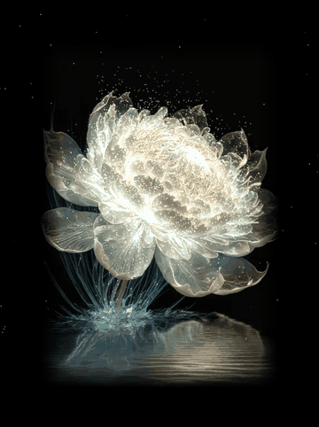

# White Flower Animation

<p align="center">

</p> <h3 align="center">A flower that feels alive.</h3> <p align="center">
  A cinematic Python animation with luminous petals, floating particles,
  breathing light, and a soft water reflection.
</p> <p align="center">
  <a href="https://github.com/Sarcasticzain/White-Flower/stargazers">
    
  </a>
  <a href="https://github.com/Sarcasticzain/White-Flower/blob/main/LICENSE">
    
  </a>
  
</p>

---

## The Idea

**White Flower Animation** turns a still flower photograph into a calm,
luminous visual experience. The flower gently breathes, its brightest petals
create a soft glow, tiny lights rise into the air, and the lower part of the
image moves like a reflection on water.

It is a small creative-coding project designed to show how Python can be used to
create atmospheric visual art—not just scripts and utilities.

## Highlights

- **Breathing light** — a subtle pulse makes the flower feel alive

- **Luminous petals** — bright parts of the image bloom with a soft glow

- **Floating particles** — tiny lights rise from the flower and fade naturally

- **Water reflection** — animated horizontal ripples add depth to the scene

- **Twinkling atmosphere** — background sparkles create a magical night effect

- **Gentle camera motion** — a slow zoom adds a cinematic touch

- **Custom image support** — use your own flower or nature photograph

- **Screenshot capture** — press `S` to save the current scene

## Preview

<p align="center">

</p>

> Run the project locally to experience the full interactive animation.

## Built With

| Technology | Purpose |
| --- | --- |
| **Python** | Core programming language |
| **Pygame CE** | Window, animation loop, rendering, and controls |
| **NumPy** | Fast pixel and particle calculations |
| **Pillow** | Image loading, resizing, and glow processing |

## Project Structure

```
White-Flower/
├── White-Flower/
│   ├── White Flower.py       # Main animation program
│   └── flower.jpg            # Flower image used by the animation
├── assets/
│   └── white-flower-preview.gif
├── LICENSE
└── README.md
```

## Installation

Clone the repository and open the project folder:

```bash
git clone https://github.com/Sarcasticzain/White-Flower.git
cd White-Flower/White-Flower
```

Install the required packages:

```bash
python -m pip install --upgrade pip
python -m pip install pygame-ce numpy pillow
```

> `pygame-ce` is recommended instead of the older `pygame` package because it
works more reliably with newer Python versions.

## Run the Animation

```bash
python "White Flower.py"
```

### Controls

| Key | Action |
| --- | --- |
| `ESC` | Close the animation |
| `S` | Save a screenshot as `white_flower_shot.png` |

## Use Your Own Flower

You can easily replace the default image with your own photograph:

1. Choose a portrait-oriented flower image.

1. For the strongest glow, use a dark or black background.

1. Rename the image to `flower.jpg`.

1. Place it next to `White Flower.py`.

1. Run the animation again.

For a PNG image, update this line in `White Flower.py`:

```python
im = Image.open("flower.jpg" ).convert("RGB")
```

to:

```python
im = Image.open("flower.png").convert("RGB")
```

## Make It Your Own

The main visual settings are at the top of `White Flower.py`:

| Setting | Effect |
| --- | --- |
| `IMG_H = 760` | Changes the flower height and window size |
| `N = 3500` | Controls the number of floating particles |
| `WATER_Y0` | Controls where the water reflection starts |
| Glow expression | Controls the breathing light intensity |
| Ripple expression | Controls the size of the water waves |
| Window caption | Changes the animation window title |

For smoother performance on a slower computer, try:

```python
IMG_H = 600
N = 1500
```

## Troubleshooting

### `ModuleNotFoundError`

Install the dependencies again:

```bash
python -m pip install pygame-ce numpy pillow
```

### `FileNotFoundError: flower.jpg`

Make sure `flower.jpg` is in the same folder as `White Flower.py`, then run the
program from that folder.

### The animation is slow or choppy

Reduce `IMG_H` and `N` in the customization section above.

### The window is too large

Reduce `IMG_H` to `600` or `500`.

## License

The source code is released under the [MIT License](LICENSE).

You may use, copy, modify, and share the code, provided that the license notice
is included. The `flower.jpg` image may have separate copyright or usage rules;
only use an image that you created, have permission to use, or that allows
redistribution.

## About

Created by **Sarcasticzain** as a creative Python and Pygame project.

If you like the project, consider giving it a star on GitHub.

<p align="center">
<a href="https://github.com/Sarcasticzain/White-Flower">View the repository</a>
</p>
